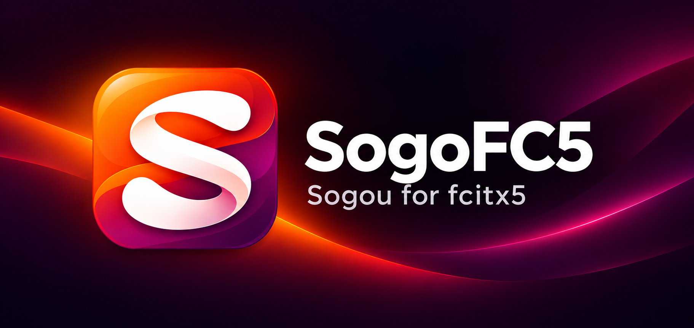

<p align="center"></p>

<h1 align="center">SogoFC5</h1>

<p align="center"><strong>适配 Fcitx5 的搜狗输入法</strong></p>

<p align="center">
  
  
  
</p>

<p align="center">
  <a href="README.md">English</a> · <strong>简体中文</strong><br />
  <a href="#快速开始">快速开始</a> · <a href="#项目功能">项目功能</a> · <a href="#开发">开发</a> · <a href="docs/USAGE.md">使用说明</a> · <a href="docs/ABI.md">ABI 参考</a>
</p>

---

SogoFC5 将搜狗官方 Linux **4.2.1.145** 引擎与词库适配到 Fcitx5。原生 C++ 模块处理按键、预编辑文本和候选展示，独立工作进程通过重建的二进制接口调用原厂引擎。在 Fcitx5 中，输入法显示为 **Sogo-FC5**。

目标环境为 **Ubuntu 24.04 amd64、X11 和 Fcitx5 5.1.7**，源码包版本为 `1.0.0`。原厂引擎仍然闭源；本仓库提供 Fcitx5 集成与接口定义。真实引擎转换、应用兼容性、学习数据持久化和长时间桌面运行行为仍需桌面验证。

> **非官方兼容项目：** Sogo-FC5 与搜狗、腾讯及相关平台厂商无官方隶属、赞助或背书关系。本项目不是搜狗原始源码的公开版本。公开仓库和 Release 不包含搜狗引擎二进制、词库或官方安装包；本地构建需自行取得适用许可的官方包。详见[权利与免责声明](#权利与免责声明)及 [NOTICE.md](NOTICE.md)。

## 快速开始

### 安装与启用

从 [Releases](https://github.com/XLYing23333/sogoFC5/releases) 获取源码归档，或克隆本仓库。公开 Release 仅提供源码、构建工具和校验文件，不提供捆绑搜狗闭源组件的 deb。

自行通过[官方渠道](https://shurufa.sogou.com/linux)取得匹配版本，并核对其适用许可后，按照[构建说明](#开发)在本机生成 Debian 包，再安装：

```sh
sudo apt install ./dist/sogo-FC5-v1.0.0_amd64.deb
```

注销并重新登录后，在 Fcitx5 配置工具中添加 **Sogo-FC5**。安装不会修改输入法分组或重启 Fcitx5。升级后也需要重新登录，使已加载模块与工作进程使用相同的通信协议。

首次使用时引擎需要初始化。若首次切入后返回英文，请等待初始化完成，再次选择 Sogo-FC5。`Ctrl+Space` 等框架快捷键遵循 Fcitx5 全局配置；如需让 Shift 正常传递，请移除全局的 Shift 切换快捷键。

### 常用操作

| 操作 | 方式 |
| --- | --- |
| 上一页候选 | 有候选时按 `-` 或 `PageUp` |
| 下一页候选 | 有候选时按 `=` 或 `PageDown` |
| 连续删除 | 长按 `Backspace`；组词删空后交还应用删除正文 |
| 切换外观 | 在输入法菜单中选择 `Dark Mode / WeLight Mode` |
| 查看诊断状态 | 执行 `sogo-fc5-direct-status` |

无组词时，`-`、`=` 保持普通符号输入；Shift 组合产生的 `_`、`+` 不用于翻页。小键盘数字与主键区候选选择键使用不同的引擎路由。字母与数字混排的实际转换仍需真实引擎验证。

主题切换会修改 Fcitx5 Classic UI 的全局外观，也会影响使用该界面的其他输入法。字体沿用现有 Fcitx5 设置。

## 项目预览

### 文件结构

| 路径 | 用途 |
| --- | --- |
| `src/` | 原生 Fcitx5 模块、工作进程、通信、编辑与界面展示 |
| `assets/` | 应用 Logo、Logo 元数据与 README 横幅 |
| `themes/` | Dark Mode 与 WeLight Mode Classic UI 主题 |
| `packaging/`、`scripts/` | Debian 元数据、资源组装、构建与校验 |
| `tests/` | 原生回归检查、模拟上下文与界面基准 |
| `abi/`、`tools/` | 固定 ABI 证据、协议提取与源码归档工具 |
| `vendor/` | 上游包身份与哈希；本地包和 SDK 由 Git 忽略 |
| `docs/` | 详细使用说明与 ABI 文档 |

## 项目功能

- **原生 Fcitx5 展示：** 预编辑文本、游标、候选与翻页交由 Fcitx5 处理；界面状态不变时避免重复更新。
- **独立引擎进程：** 请求与回复按序处理，应用结果前校验输入上下文、代次与序号。
- **故障恢复：** 请求失败或超时时取消组词、按序回放未确认按键并切回英文。工作进程恢复后需重新选择 Sogo-FC5。请求截止时间是恢复策略，不是桌面硬实时保证。
- **私有引擎配置：** 配置与学习数据独立存放，限制目录权限，并通过独占锁保护同一份数据。
- **不含输入内容的诊断：** 记录就绪状态、请求计数、耗时摘要与故障原因；诊断记录不包含按键内容、拼音、候选或提交文本。原厂学习数据与诊断记录分开存放。

### 数据与诊断

| 项目 | 位置或行为 |
| --- | --- |
| 私有数据根目录 | `$XDG_DATA_HOME/sogo-fc5-direct`；未设置时为 `$HOME/.local/share/sogo-fc5-direct` |
| 原厂配置目录 | 私有数据根目录内的 `home/.config/sogoupinyin` |
| 运行状态 | `$XDG_RUNTIME_DIR/sogo-fc5-direct/status.json` |
| 已有数据 | 保留配置与学习文件；不自动迁移旧引擎配置 |
| 卸载 | `sudo apt remove sogo-fc5`；保留用户数据 |

导出当前状态：

```sh
sogo-fc5-direct-status > direct-status.json
```

耗时统计覆盖引擎处理、通信交付与同步界面调用，不包含按键到达模块前的前端耗时或应用、合成器的异步绘制。字段定义、恢复行为及可选引擎探针见[使用说明](docs/USAGE.md)。探针会执行原厂代码并打开私有配置，不应与使用同一份数据的工作进程同时运行。

## 开发

在源码根目录执行构建命令。所需工具与开发库：

- CMake 3.16 或更新版本、Ninja、支持 C++17 的编译器、Python 3、GNU binutils 和 `dpkg-dev`。
- Qt5 Core 5.15 或更新版本，以及目标环境的 Fcitx5 Core/Config/Utils 开发文件。
- 可选：`protoc` 和 protobuf 开发文件，用于恢复的协议源码检查。
- 与 [vendor/baseline.json](vendor/baseline.json) 匹配的官方 `sogoupinyin_4.2.1.145_amd64.deb`。清单记录下载地址、整包哈希和关键二进制哈希；源码树不包含该包或可选 SDK。

将上游包放入 `vendor/packages/` 后构建：

```sh
sh scripts/build-deb.sh \
  vendor/packages/sogoupinyin_4.2.1.145_amd64.deb \
  dist/sogo-FC5-v1.0.0_amd64.deb
```

若使用已解包的 Ubuntu 24.04 Fcitx5 开发文件，而非系统已安装的开发文件，可在命令末尾追加第三个参数 `vendor/sdk/noble`。

脚本校验哈希、解包上游包但不执行其维护脚本，随后编译、运行 CTest、组装 Debian 包并检查包内容与依赖。输出包含成品包及 `.sha256` 文件，不安装成品或重启输入法。`SOGO_JOBS` 设置构建并行度，默认为 `2`；`SOGO_BUILD_PARENT` 设置临时构建目录的父目录，默认为 `/tmp`。

生成源码归档：

```sh
python3 tools/pack_source.py dist/sogo-FC5-v1.0.0-source.tar.gz
```

归档不包含本地上游包、SDK 或构建产物。Python 和 protobuf 用于构建与检查，不是原生模块和工作进程的运行时依赖。

### 验证范围

CTest 覆盖按键路由、队列、通信、编辑、结果缓冲、私有配置、模拟 Fcitx5 界面、调度、耗时计数与 ABI 约定。构建脚本启用固定上游二进制的静态检查；protobuf 可用时启用恢复的协议源码检查。

这些检查不能证明真实中文转换、桌面输入顺序、学习数据持久化、应用兼容性或候选窗实际外观。界面基准使用模拟上下文，不代表桌面端到端延迟。技术边界详见 [docs/USAGE.md](docs/USAGE.md) 和 [docs/ABI.md](docs/ABI.md)。

## 许可证

本仓库未为集成源码提供许可证文件；公开可见不等于授予开源许可或第三方材料的使用许可。搜狗引擎、词库及其他第三方材料仍受各自权利与适用许可约束。本地组装的 Debian 包保留原厂许可文件，不应据此推定获得再分发授权。

## 权利与免责声明

- **独立维护：** 本项目用于 Fcitx5 兼容适配，不是搜狗、腾讯、麒麟、Canonical 或 Fcitx 官方发布的软件，也未声称得到上述主体授权、赞助或认可。
- **商标归属：** 搜狗 / Sogou 等名称、商标与第三方标识归各自权利人所有。项目名称、Logo 及兼容性描述不表示任何官方关系，也不授予商标使用权。
- **第三方组件：** 本项目不声称拥有搜狗引擎、词库及原厂资源的权利，也不提供这些组件的再分发许可。`abi/` 含接口定义、提取的协议描述和有限反汇编证据；它们不等于原厂源码或原厂对本项目的许可。
- **许可边界：** 使用、构建、修改、传播或商业使用前，应核对适用法律、实际软件包许可及必要授权。[搜狗安装使用协议](https://pinyin.sogou.com/help.php?list=9&q=1)仅作为原厂条款入口；“学习研究”“非商业”或“侵删”不自动产生合法性、授权或免责。
- **无担保：** 在适用法律允许范围内按现状提供，不保证兼容性、连续输入、数据安全或不受第三方权利主张影响；不排除依法不得排除的责任。备份学习数据，并自行评估在重要输入场景使用的风险。
- **权利反馈：** 权利人可通过 [Issues](https://github.com/XLYing23333/sogoFC5/issues) 提供具体文件、权利依据及必要说明，以便核查并酌情修正或移除。请勿在公开 Issue 上传敏感身份证明、输入记录或凭据。

完整说明见 [NOTICE.md](NOTICE.md)。本说明不替代第三方授权，也不保证免于法律争议。
