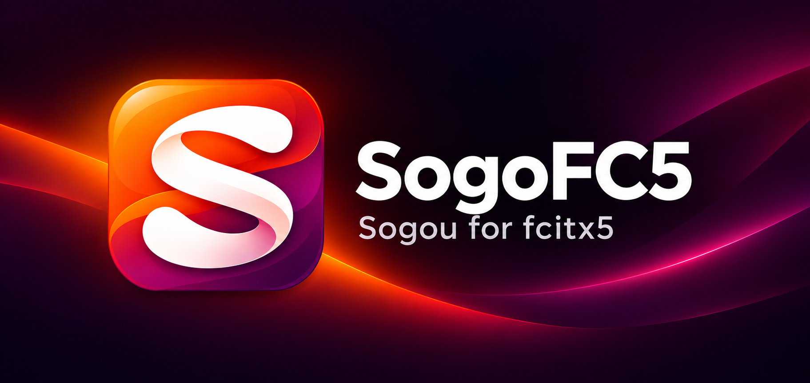

<p align="center"></p>

<h1 align="center">SogoFC5</h1>

<p align="center"><strong>Sogou for fcitx5</strong></p>

<p align="center">
  
  
  
</p>

<p align="center">
  <strong>English</strong> · <a href="README-CN.md">简体中文</a><br />
  <a href="#quick-start">Quick Start</a> · <a href="#features">Features</a> · <a href="#development">Development</a> · <a href="docs/USAGE.md">Usage Guide (Chinese)</a> · <a href="docs/ABI.md">ABI Reference (Chinese)</a>
</p>

---

SogoFC5 adapts the official Sogou Linux **4.2.1.145** engine and dictionaries to Fcitx5. A native C++ module handles key events, preedit text and candidates, while a separate worker calls the vendor engine through reconstructed binary interfaces. The input method appears as **Sogo-FC5** in Fcitx5.

The target environment is **Ubuntu 24.04 amd64 with X11 and Fcitx5 5.1.7**. The source package version is `1.0.1`. The vendor engine remains closed source; this repository supplies the Fcitx5 integration and interface definitions. Real engine conversion, application compatibility, learning-data persistence and long-running desktop behavior still require desktop verification.

> **Unofficial compatibility project:** Sogo-FC5 is not affiliated with, sponsored by or endorsed by Sogou, Tencent or the platform vendors. It is not a publication of Sogou's original source code. The public repository and releases exclude Sogou engine binaries, dictionaries and upstream installers; local builds require a separately obtained official package under its applicable terms. See [Rights and disclaimer](#rights-and-disclaimer) and [NOTICE.md](NOTICE.md).

## Quick Start

### Install and enable

Get the source archive from [Releases](https://github.com/XLYing23333/sogoFC5/releases), or clone this repository. Public releases provide source, build tools and checksums, without a Debian package bundling proprietary Sogou components.

Obtain the matching package separately through the [official distribution channel](https://shurufa.sogou.com/linux), review its applicable terms, then build a Debian package locally using the [build instructions](#development) and install it:

```sh
sudo apt install ./dist/sogo-FC5-v1.0.1_amd64.deb
```

Log out and log back in, then add **Sogo-FC5** in Fcitx5's configuration tool. Installation does not change your input-method groups or restart Fcitx5. Logging in again is also necessary after an upgrade so that the loaded module and worker use the same protocol.

The engine initializes on first use. If the first activation returns to English, wait for initialization and select Sogo-FC5 again. Framework shortcuts such as `Ctrl+Space` follow your Fcitx5 global settings; remove a global Shift switching shortcut if you want Shift to pass through normally.

### Everyday controls

| Action | Control |
| --- | --- |
| Previous candidate page | `-` or `PageUp` while candidates are present |
| Next candidate page | `=` or `PageDown` while candidates are present |
| Continuous deletion | Hold `Backspace`; deletion returns to the application after composition becomes empty |
| Change appearance | Select `Dark Mode / WeLight Mode` in the input-method menu |
| Read diagnostic status | Run `sogo-fc5-direct-status` |

`-` and `=` remain ordinary symbols outside composition; Shift combinations `_` and `+` do not page candidates. Numeric keypad digits use a separate engine route from the main-row candidate selection keys. Actual mixed letter/digit conversion still requires real-engine verification.

Theme switching changes Fcitx5 Classic UI's global appearance, including other input methods that use it. Fonts follow the existing Fcitx5 settings.

## Project Preview

### Project structure

| Path | Purpose |
| --- | --- |
| `src/` | Native Fcitx5 module, worker, transport, editing and presentation |
| `assets/` | Application logo, logo metadata and README banner |
| `themes/` | Dark Mode and WeLight Mode Classic UI themes |
| `packaging/`, `scripts/` | Debian metadata, staging, build and validation |
| `tests/` | Native regression checks, simulated contexts and presentation benchmark |
| `abi/`, `tools/` | Pinned ABI evidence, protocol extraction and source-archive tools |
| `vendor/` | Upstream identity and hashes; local packages and SDK are ignored by Git |
| `docs/` | Detailed usage and ABI documentation |

## Features

- **Native Fcitx5 presentation:** preedit text, cursor, candidates and paging use Fcitx5. Unchanged presentation state avoids redundant UI updates.
- **Separate engine process:** ordered requests and replies are checked against the input context, generation and sequence before application.
- **Fault recovery:** failed or overdue requests cancel composition, replay unacknowledged keys in order and switch to English. Select Sogo-FC5 again after the worker recovers. The request deadline is a recovery policy, not a hard real-time desktop guarantee.
- **Private engine profile:** isolated configuration and learning files, restricted directory permissions and an exclusive profile lock.
- **Content-free diagnostics:** readiness, request counts, timing summaries and fault reasons; diagnostic records omit key contents, pinyin, candidates and committed text. Vendor learning data is separate from diagnostics.

Learning data is checkpointed after roughly 2 seconds idle following a commit, or roughly 30 seconds during continuous input. Normal shutdown, including termination signals, requests native synchronized saving. `sogo-fc5-direct-status --learning` reports content-free save state. A returned call is not proof of per-file durability; real learning across reboot still requires verification. See the [persistence guide (Chinese)](docs/USAGE.md#学习数据持久化).

### Data and diagnostics

| Item | Location or behavior |
| --- | --- |
| Private data root | `$XDG_DATA_HOME/sogo-fc5-direct`, or `$HOME/.local/share/sogo-fc5-direct` when unset |
| Vendor profile | `home/.config/sogoupinyin` inside the private data root |
| Runtime status | `$XDG_RUNTIME_DIR/sogo-fc5-direct/status.json` |
| Existing data | Configuration and learning files are preserved; legacy profiles are not migrated automatically |
| Removal | `sudo apt remove sogo-fc5`; user data is retained |

Capture the current status with:

```sh
sogo-fc5-direct-status > direct-status.json
```

Timings measure engine processing, delivery and synchronous presentation work. They exclude frontend time before a key reaches the module and asynchronous application/compositor drawing. See the [usage guide](docs/USAGE.md) for field definitions, recovery behavior and the optional engine probe. The probe executes vendor code and opens the private profile; do not run it alongside a worker using the same data.

## Development

Run build commands from the source root. Required tools and development libraries:

- CMake 3.16 or newer, Ninja, a C++17 compiler, Python 3, GNU binutils and `dpkg-dev`.
- Qt5 Core 5.15 or newer and Fcitx5 Core/Config/Utils development files for the target environment.
- Optional: `protoc` and protobuf development files for the recovered protocol-source check.
- The official `sogoupinyin_4.2.1.145_amd64.deb` matching [vendor/baseline.json](vendor/baseline.json). This manifest records its download URL, package hash and critical binary hashes. The package and optional SDK are not included in the source tree.

Place the upstream package in `vendor/packages/`, then build:

```sh
sh scripts/build-deb.sh \
  vendor/packages/sogoupinyin_4.2.1.145_amd64.deb \
  dist/sogo-FC5-v1.0.1_amd64.deb
```

If using extracted Ubuntu 24.04 Fcitx5 development files instead of system-installed development files, append `vendor/sdk/noble` as the third argument.

The script verifies hashes, extracts the upstream package without running its maintenance scripts, compiles, runs CTest, assembles the Debian package and checks its contents and dependencies. It writes the package and a `.sha256` sidecar, without installing the package or restarting the input method. `SOGO_JOBS` sets build parallelism (default: `2`); `SOGO_BUILD_PARENT` selects the temporary build parent (default: `/tmp`).

Create a source archive with:

```sh
python3 tools/pack_source.py dist/sogo-FC5-v1.0.1-source.tar.gz
```

Local vendor packages, the SDK and build outputs are excluded. Python and protobuf are build/check tools, not runtime dependencies of the native module and worker.

### Verification scope

CTest covers key routing, queues, transport, editing, result buffers, private profiles, simulated Fcitx5 presentation, scheduling, timing counters and ABI contracts. The build script enables static checks against the pinned upstream binaries; the recovered protocol-source check is enabled when protobuf is available.

These checks do not establish real Chinese conversion, desktop input ordering, learning-data persistence, application compatibility or candidate-window appearance. The presentation benchmark uses simulated contexts and does not measure desktop end-to-end latency. See [docs/USAGE.md](docs/USAGE.md) and [docs/ABI.md](docs/ABI.md) for technical boundaries.

## License

This repository does not provide a license file for its integration source. Public visibility is not an open-source license or permission to use third-party materials. The Sogou engine, dictionaries and other third-party materials remain subject to their respective rights and applicable terms. Locally assembled Debian packages retain upstream notices; this does not establish redistribution permission.

## Rights and disclaimer

- **Independent maintenance:** this Fcitx5 compatibility project is not an official release of Sogou, Tencent, Kylin, Canonical or Fcitx. No authorization, sponsorship or endorsement by those parties is claimed.
- **Trademarks:** Sogou / 搜狗 and other third-party names, trademarks and identifiers belong to their respective rights holders. Project naming, artwork and compatibility references neither imply an official relationship nor grant trademark rights.
- **Third-party components:** the project asserts no ownership of the Sogou engine, dictionaries or upstream resources and grants no redistribution rights to them. `abi/` contains interface definitions, extracted protocol descriptors and limited disassembly evidence, not the vendor's original source tree or a license from the vendor.
- **Permission boundaries:** review applicable law, the exact package terms and any required permissions before use, building, modification, distribution or commercial use. The [Sogou installation agreement](https://pinyin.sogou.com/help.php?list=9&q=1) is an upstream terms reference; research intent, noncommercial use or a removal-on-request statement does not itself establish permission, legality or immunity.
- **No warranty:** to the extent permitted by applicable law, the project is provided as is, without warranties of compatibility, uninterrupted input, data preservation or freedom from third-party claims. Non-excludable obligations remain unaffected. Back up learning data and assess suitability for important input tasks.
- **Rights reports:** rights holders may identify specific files, the asserted rights and supporting information through [Issues](https://github.com/XLYing23333/sogoFC5/issues), for review and correction or removal where appropriate. Do not post sensitive identity documents, input records or credentials in public issues.

See [NOTICE.md](NOTICE.md) for the full notice. These statements do not replace third-party permission or guarantee freedom from legal disputes.
